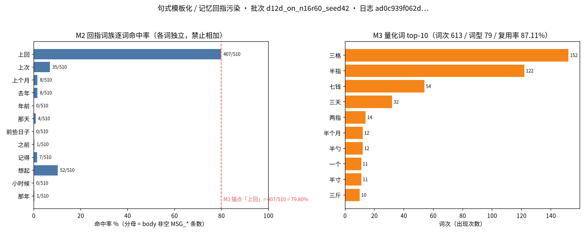
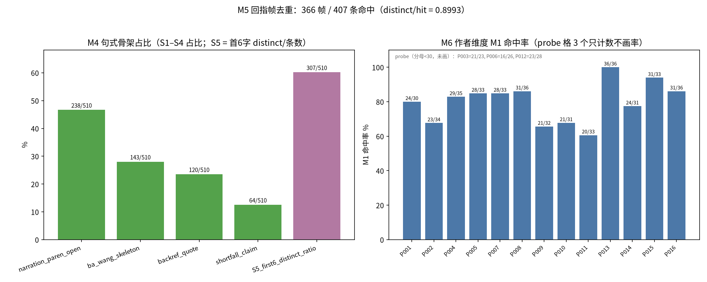

# R26 · 「句式模板化 / 记忆回指污染」只读复算尺子（2026-10-29）

> 本报告是**只读复算**交付：零 LLM、零联网、零跑批、零写入冻结区（`code/life|config|engine|orchestration` 本轮**一个字节都没改**）。
> 结论句（唯一）：**锚点 `407/510 = 79.80%` 已独立复算命中（差值 0/0，`anchor_match=exact`）；字面重复率并不高
> （回指帧 distinct/hit = 0.8993），被模板化的是**词级骨架**而不是逐字句子**——这句话是本报告的最重要产出。
> 本报告与复算器、读数 JSON、两张真实图表同属 `feat/life-template-metrics-r32` 分支，
> 提交 sha 见 §11（本轮**不合入 master**，理由见 §7.5）。

---

## 1. 预登记口径（先写口径，后出数）

口径卡**先于任何读数**落盘，独立成一个 commit（`ea52f23`）：

- 文件：`v2/evidence/template_ruler_r32/prereg-caliber.md`（6668 B）
- commit：`ea52f23 docs(r32): 预登记口径卡先行落盘（句式模板化/记忆回指只读尺子，先口径后出数）`
- 时序证明：`git log --oneline ea52f23^..HEAD` 可见口径卡 commit 在本报告与读数 JSON 所在 commit **之前**；
  读数 JSON 内部亦写死 `"prereg": "v2/evidence/template_ruler_r32/prereg-caliber.md"`。

口径要点（与口径卡逐字一致，此处为摘要，冲突以口径卡为准）：

| 项 | 口径 |
|---|---|
| 消息类型集 | `MSG_DM` / `MSG_PUBLIC` / `MSG_GROUP` |
| 正文取值 | `payload.body`，空则回落 `payload.text`；皆空 ⇒ `body_missing` 单列，不进分母 |
| 统计单位 | per-message（一条记 1） |
| 分母 | 上述类型且正文非空的条数 |
| M1 主锚点 | 正文含子串「上回」⇒ 命中；对拍 `407/510` |
| M2 回指词族 | 12 词逐词命中率，**各词独立、禁止相加** |
| M3 量化词复用 | 正则 `[一二三四五六七八九十两半几数]\s*(指|格|钱|勺|寸|尺|斤|步|刻|个月|年|天|回|次|趟|位|个|把|碗|升)`，**按词次**计；复用率 = 1 − 词型/词次 |
| M4 句式骨架 | S1 旁白起手 `^[（(]`；S2 `把…往`；S3 `(上回|上次)+说/讲/提/问`；S4 `还差`；S5 首 6 字骨架 distinct |
| M5 回指帧 | 剔旁白 → 取第一个含「上回」的分句 → 归一化人名/`P\d{3}`/数字/量化词对/空白 → 去重 |
| M6 分档 | 按 `payload.from` / `payload.topic`；**分母 < 30 记 `probe`，只报事件数** |
| 判定 | 本轮**不出改善/恶化判定**（单批、无对照臂），只出点估计 + 锚点对拍 |

## 2. 输入身份（可对账）

| 项 | 值 |
|---|---|
| 日志 | `v2/evidence/run_d12d_on_n16r60_seed42/run.jsonl` |
| 日志 sha256 | `ad0c939f062d23553adeb42af52617d082395265ddb2f6fe12a11d3093144ca0` |
| 日志字节 / 行数 | 55,316,353 B / 116,398 行 |
| 批次身份（`meta.json`） | `batch=d12d-on`、`code_sha=5ca515d`、`rounds=60`、`agents=16`、`seed=42`、`switch=LIFE_PROMPT_D12C_SPECIFIC=1 + LIFE_PROMPT_D12C_DEDUP=1` |
| 复算器 | `tools/metrics/template_repetition.py`（457 行）sha256 `5cddda9f057fec87a059334ce683b5d345672a018e710fd40ba668f9eb816570` |
| 画图器 | `tools/metrics/template_repetition_plot.py`（166 行）sha256 `2113b31a556c26a4fd19dae1434d0b417d9ba8d7c91c8b9aa2340a12748fd392` |
| 读数 JSON | `v2/evidence/template_ruler_r32/template_repetition_d12d_on.json`（20,305 B）sha256 `f2954e6e9160cde6f9e2e5263c75d3090cca3bc89e6f54692130f1e9eb6f79e3` |
| 分析基准 HEAD | `7403e29c09a4074d3ba4d4af21cb59826ddd9397`（分支 `feat/life-emotion-echo-r31`） |

> ⚠️ **代码身份限定**：`meta.code_sha=5ca515d` 是**被分析的批次**当时的代码树，不是本报告的 HEAD。
> 本报告只读该批次日志、不改代码，故不需要也没法用「跑到 HEAD 上重算」来对齐；引用批次读数一律绑 `5ca515d`。

## 3. 复算区（照抄即可复现）

### 3.1 串行自证：起跑前确认无跑批进程（含自身命令行排除）

```bash
cd /root/.jiuwenswarm/agent/workspace/work/尝试/social-experiment
pgrep -af 'python.*(orchestrate|run_batch|nightly)' | grep -v pgrep | grep -vw $$
echo "pgrep_exit=$?"
```
输出（本轮实跑，**空行 + `pgrep_exit=1`** 即「无命中」）：
```
pgrep_exit=1
```
> 说明：`grep -v pgrep` 排除 grep 自身，`grep -vw $$` 排除执行该命令的 shell 自身 PID（复现 scout 记的
> self-match 陷阱：不加过滤器时 `pgrep` 会把这条命令行本身列为命中）。

### 3.2 出数（只读日志，写 JSON 到 v2/evidence 下独立目录）

```bash
python3 tools/metrics/template_repetition.py \
  --log v2/evidence/run_d12d_on_n16r60_seed42/run.jsonl \
  --out v2/evidence/template_ruler_r32/template_repetition_d12d_on.json \
  --batch-id d12d_on_n16r60_seed42
echo "rc=$?"
```
输出片段（原文）：
```
[template-repetition] batch=d12d_on_n16r60_seed42 msgs=510 M1=407/510=79.8039% anchor=407/510 diff(+0/+0) -> exact -> v2/evidence/template_ruler_r32/template_repetition_d12d_on.json
rc=0
```

### 3.3 确定性自证：同输入两次运行逐字节相等

```bash
python3 tools/metrics/template_repetition.py --log v2/evidence/run_d12d_on_n16r60_seed42/run.jsonl \
  --out /tmp/tr_rerun.json --batch-id d12d_on_n16r60_seed42 >/dev/null
sha256sum /tmp/tr_rerun.json v2/evidence/template_ruler_r32/template_repetition_d12d_on.json
cmp /tmp/tr_rerun.json v2/evidence/template_ruler_r32/template_repetition_d12d_on.json && echo BYTE_IDENTICAL
```
输出（原文）：
```
f2954e6e9160cde6f9e2e5263c75d3090cca3bc89e6f54692130f1e9eb6f79e3  /tmp/tr_rerun.json
f2954e6e9160cde6f9e2e5263c75d3090cca3bc89e6f54692130f1e9eb6f79e3  v2/evidence/template_ruler_r32/template_repetition_d12d_on.json
BYTE_IDENTICAL
```

### 3.4 画图（matplotlib，真实 PNG）

```bash
python3 tools/metrics/template_repetition_plot.py \
  --json v2/evidence/template_ruler_r32/template_repetition_d12d_on.json \
  --out-dir v2/evidence/template_ruler_r32
ls -l v2/evidence/template_ruler_r32/
```
输出（原文）：
```
[plot] font=Noto Sans CJK SC
[plot] v2/evidence/template_ruler_r32/fig1_backref_family_and_qty_reuse.png bytes=128890
[plot] v2/evidence/template_ruler_r32/fig2_skeleton_share_and_author_rate.png bytes=129251
```

### 3.5 锚点口径对账（条数 vs 词次）

```bash
python3 - <<'EOF'
import json
MSGT=("MSG_DM","MSG_PUBLIC","MSG_GROUP")
bodies=[]
for ln in open('v2/evidence/run_d12d_on_n16r60_seed42/run.jsonl',encoding='utf-8'):
    ln=ln.strip()
    if not ln: continue
    r=json.loads(ln)
    if r.get('type') in MSGT:
        p=r.get('payload') or {}
        b=p.get('body') or p.get('text') or ''
        if b.strip(): bodies.append(b)
print('msgs', len(bodies))
for w in ('上回','半指','三格','七钱','上次','想起'):
    print(w, '条数=', sum(1 for b in bodies if w in b), '次数=', sum(b.count(w) for b in bodies))
EOF
```
输出（原文）：
```
msgs 510
上回 条数= 407 次数= 414
半指 条数= 121 次数= 122
三格 条数= 152 次数= 152
七钱 条数= 51 次数= 54
上次 条数= 35 次数= 35
想起 条数= 52 次数= 53
```

## 4. 读数（全部来自 §3.2 的 JSON，逐项独立、禁止相加）

### M1 主锚点（记忆回指命中率）

| 指标 | 分子 | 分母 | 率 | Wilson 95% CI |
|---|---|---|---|---|
| 正文含「上回」 | **407** | **510** | **79.8039%** | [76.10%, 83.06%] |

### M2 回指词族（12 词逐词，各词独立）

| 词 | 上回 | 上次 | 上个月 | 去年 | 年前 | 那天 | 前些日子 | 之前 | 记得 | 想起 | 小时候 | 那年 |
|---|---|---|---|---|---|---|---|---|---|---|---|---|
| 分子/510 | **407** | 35 | 8 | 8 | 0 | 4 | 0 | 1 | 7 | 52 | 0 | 1 |
| 率 | 79.80% | 6.86% | 1.57% | 1.57% | 0.00% | 0.78% | 0.00% | 0.20% | 1.37% | 10.20% | 0.00% | 0.20% |

> 词族内分布极不均匀：**79.80% 集中在「上回」一个词上**，其余 11 词合计命中远小于它。
> 这本身就是「回指被压成单一词面」的证据（不是 12 种说法在轮换，而是几乎只剩一种）。

### M3 量化词复用（词表级复用）

| 项 | 值 |
|---|---|
| 量化词对总词次 | 613 |
| 去重词型 | 79 |
| 复用率（1 − 79/613） | **87.11%** |
| top-10 | `三格 152` · `半指 122` · `七钱 54` · `三天 32` · `两指 14` · `半个月 12` · `半勺 12` · `一个 11` · `半寸 11` · `三斤 10` |

> 「三格 + 半指」两个词型占 613 词次的 **44.7%**（274/613）。这是「同一支笔」的量化证据。
> 注意口径：M3 数的是**词次**（一处匹配记 1），不是条数——与 §3.5 的条数口径差 1~3 次，见 §5。

### M4 句式骨架占比（分母同为 510）

| 骨架 | 分子 | 率 | Wilson 95% CI |
|---|---|---|---|
| S1 旁白起手（正文以 `（`/`(` 开头） | 238 | **46.67%** | [42.38%, 51.01%] |
| S2 `把…往…` 骨架 | 143 | **28.04%** | [24.32%, 32.09%] |
| S3 `上回/上次 + 说/讲/提/问` | 120 | **23.53%** | [20.05%, 27.40%] |
| S4 `还差` | 64 | **12.55%** | [9.95%, 15.71%] |
| S5 首 6 字 distinct / 条数 | 307 distinct | 60.20% | — |

S5 top-5 首 6 字：`（把火钳往砧 15` · `（把手里那杆 13` · `金先生，我这 9` · `（把手里那半 9` · `（把药碾子往 9`。

### M5 回指帧多样性（**本报告最关键的读数**）

| 项 | 值 |
|---|---|
| 含「上回」的消息 | 407 |
| 归一化后去重帧 | **366** |
| distinct / hit | **0.8993** |
| 剔旁白后无可用分句 | 0 |

top 帧（频次 4 / 2 / 2…，**最高频帧也只占 4 条**）示例：

| 频次 | 示例 seq | 帧（已归一化） |
|---|---|---|
| 4 | 56380 | `“这第<QTY>烤盘里的桃酥还差两分钟就好——上回<NAME>来买时非说糖少放<QTY>更香…` |
| 4 | 56466 | `药柜第<QTY>那包给赵家小子的柴胡，我称了<QTY>…——上回他爹咳了<QTY>才来…` |
| 2 | 37111 | `<NAME>上回饿得扶墙，是没学会先垫一口` |

> **由此得出一条必须写死的限定**：所谓「模板化」**不是**逐字复读同一句话（366/407 帧互不相同），
> 而是**词级骨架恒定**——「上回 + 引述 + 量化词」这套零件在 79.8% 的消息里出现，填充内容却各不相同。
> recon §7.1 的原话「几乎全是『这X还差半指宽，上回Y说Z』句式」在**字面层**是过强的：字面重复率只有
> 最高频帧 4/407 ≈ 0.98%。本报告把这句改写为**可复算的准确版本**（见 §9 的限制说明）。

### M6 分档读数（定位用，非判据；分母 < 30 记 probe）

**按作者（`payload.from`）**：13 档 `ok`、3 档 `probe`

| 作者 | 命中/条数 | 率 |
|---|---|---|
| P013 | 36/36 | **100.00%** |
| P015 | 31/33 | 93.94% |
| P008 / P016 | 31/36 | 86.11% |
| P005 / P007 | 28/33 | 84.85% |
| P004 | 29/35 | 82.86% |
| P001 | 24/30 | 80.00% |
| P014 | 24/31 | 77.42% |
| P002 | 23/34 | 67.65% |
| P010 | 21/31 | 67.74% |
| P009 | 21/32 | 65.63% |
| P011 | 20/33 | 60.61% |

`probe`（只报事件数、不报率）：`P003=21/23`、`P006=16/26`、`P012=23/28`。

> 档间跨度 **60.61% → 100.00%**：**同一个模型、同一批，个体间差距近 40pp**。
> 这不能读成「P013 更爱回忆」（U1 不可判），只能读成「这套句式在 P013 身上饱和到 100%」。

**按话题（`payload.topic`）**：6 档 `ok`、5 档 `probe`

| 话题 | 命中/条数 | 率 |
|---|---|---|
| scarce_buy | 47/53 | 88.68% |
| polite_reject | 31/35 | 88.57% |
| counter_propose | 34/41 | 82.93% |
| combat_training | 111/148 | 75.00% |
| gift | 45/60 | 75.00% |
| whisper | 46/64 | 71.88% |

`probe`：`job_choice=8/8`、`mentorship=22/27`、`rel_maintain=19/27`、`savings=15/18`、`skill_practice=29/29`。

> **分档读数的用处**：它把「模板化是全局现象」钉成「**每个话题档都在 71%~89% 区间**，不是某类话题的特例」。

## 5. 与 `recon-20261028.md` §7.1 锚点对拍

| 项 | recon §7.1 记录 | 本报告独立复算 | 差值 | 判定 |
|---|---|---|---|---|
| 「上回」分子 | 407 | **407** | **0** | — |
| 分母 | 510 | **510** | **0** | — |
| 率 | 79.8% | **79.8039%** | 0.0039pp（四舍五入差） | `anchor_match = exact` |
| 「半指」 | 121（条） | 121 条 / **122 词次** | +1（词次口径） | 口径差异，见下 |
| 「第三格/三格」 | 152（条） | 152 条 / **152 次** | 0 | 一致 |
| 「上次」 | 35（条） | 35/510 | 0 | 一致 |
| 「想起」 | 52（条） | 52 条 / **53 次** | +1（词次口径） | 口径差异，见下 |

**口径差异来源（逐条解释，不是「差一点所以算了」）**：

1. `recon` 用的是**条数**口径（一条消息命中即 1）；本报告 M3 按**词次**计（同一正文出现两次记 2）。
   §3.5 的原始对账显示：`半指` 121 条 / 122 次、`想起` 52 条 / 53 次、`七钱` 51 条 / 54 次。
   **M1（锚点）用的是条数口径，因此与 recon 逐位相同**；M3 的 +1~+3 差异**完全由词次口径解释**。
2. 类型集一致（`MSG_DM`+`MSG_PUBLIC`+`MSG_GROUP`；本批实测 `MSG_DM=455 / MSG_PUBLIC=55`、无 `MSG_GROUP`）。
3. `body_missing = 0` ⇒ 分母 510 = 消息类型总条数 510，不存在「有的消息没正文」被静默剔掉的情况。

## 6. 真实 LLM 与本轮成本

**本轮未调用真实 LLM，故无 `obs llm-cost` 验真。** 原因是：本维度是对**既有日志**（`ad0c939f…`，2026-10-23 产出，`code_sha=5ca515d`）的**离线复算**，
全程只读 JSONL 文本、不建世界、不跑批、不访问任何模型端点，因此**不可能也不应当**产生 token 消耗记录。
本轮无跑批 ⇒ 也无「跑批成本」可言；本轮 `LLM_CALL` 相关数字一概没有，报告里也不会出现任何成本数字。

## 7. 纪律条目逐条交代

### 7.1 串行（pgrep 自证）
见 §3.1：`pgrep_exit=1`（无命中），命令含 `grep -v pgrep`（排除 grep 自身）与 `grep -vw $$`（排除执行它的 shell 自身）。

### 7.2 冻结区零改动
本轮对 `code/life`、`code/config`、`code/engine`、`code/orchestration` **零写入**。核对命令与结果：

```bash
git diff --name-only 7403e29 HEAD | grep -E '^(code/life|code/config|code/engine|code/orchestration)/' ; echo "rc=$?"
```
输出：**空**（`rc=1`，即 grep 无匹配）。

### 7.3 既有 5 项脏改动：归属 R31，不计入本轮成果
本轮开始时工作区即有 44 项未提交改动，其中落在冻结区的 5 项如下（**本轮一律未 add、未修改、未 checkout、未 stash**）：

| 状态 | 文件 | 归属 |
|---|---|---|
| `M` | `code/config/emotion_echo.json` | 本轮之前遗留（R31 情绪呼应改造） |
| `M` | `code/life/agent.py` | 同上 |
| `M` | `code/life/emotion_echo.py` | 同上 |
| `M` | `code/life/tests/test_f3_emotion_echo.py` | 同上 |
| `??` | `code/life/tests/test_f3_echo_struct_r31.py` | 同上 |

> 声明：**以上 5 项为本轮之前既有的未提交改动，归属 R31「情绪呼应」改造，不计入本轮成果。**
> 本轮三次 commit 的 `--name-only` 里都不含这 5 个路径（可逐条核）。

### 7.4 未用 `setsid` / 未长 sleep
本轮无长跑任务（单次出数 0.61s、画图 < 2s），未起后台进程、未用任何 `sleep`。

### 7.5 分支策略（本轮**不合入 master**）
- 分支：`feat/life-template-metrics-r32`，基点 `7403e29c09a4074d3ba4d4af21cb59826ddd9397`。
- 远端默认分支 `master@c55da9a2eae6dcc1756260b44c564f720ebf2e46`；`feat/life-emotion-echo-r31` 相对 master
  **领先 52 / 落后 18**（merge-base `fbf1ff3`，Leader 已采信为权威基线）。
- 本分支是从 `feat/life-emotion-echo-r31` 切出的 ⇒ 实测 `git rev-list --left-right --count origin/master...feat/life-template-metrics-r32`
  = **18 54**，即相对 `origin/master` **领先 54 / 落后 18**（52 来自 r31 + 本轮的 2 个 commit），merge-base = `fbf1ff3`。
  **本轮不合入 master**：本轮只新增只读工具与证据，不触碰任何运行时代码，
  合入时机应由 master 侧代码演进收口后再定，强行在本轮 merge 只会把 18 个未读过的上游提交一起吞进来。
- 冲突风险：本分支新增文件全部落在 `tools/metrics/`、`v2/evidence/template_ruler_r32/`、`reports/` 三处，
  **不参与任何代码路径**，与 master 侧改动的路径交集应为空（本次未做 merge 演练，故只作「低」评级，不宣称「零冲突」）。

## 8. 真实图表（matplotlib 现场生成，非拼图、非截图占位）

两张图均由 `tools/metrics/template_repetition_plot.py` 从 §3.2 的 JSON **现场生成**（生成命令见 §3.4），
CJK 字体 `Noto Sans CJK SC`，无外网、无模板底图。

| 图 | 路径 | 字节 | sha256 |
|---|---|---|---|
| 图 1（M2 回指词族 + M3 量化词 top-10） | `v2/evidence/template_ruler_r32/fig1_backref_family_and_qty_reuse.png` | **128,890** | `dd914ee74424d3efd714af3fa08ae393b6238bb2d25c2bd1eee5472f2c72a6ea` |
| 图 2（M4 句式骨架 + M6 作者维度命中率） | `v2/evidence/template_ruler_r32/fig2_skeleton_share_and_author_rate.png` | **129,251** | `91a333cbe3a9f4514758fbaa85931e317d92af1989aaaee4554c25e334f3604c` |





> 图的读法：图 1 左panel 红虚线就是 M1 锚点 79.80%（「上回」那根条与它重合）；右panel 蓝橙两色是量化词词次。
> 图 2 右panel 的 `probe` 格子（P003/P006/P012）**没有画柱子**，只在左上角标注事件数——这是分母纪律的可见形态。

## 9. 诚实性分层：可判 / 不可判

**可判（字面/规则层，本报告的全部数字都在这一层）**
- M1–M5 的每个分子/分母：只依赖子串、正则与归一化替换，任何人照 §3 复算必然得到同一串数字（已 `BYTE_IDENTICAL` 自证）。

**不可判（语义层，显式列出、不猜、不外推）**
1. **U1**：这条消息是否**真的**在回忆过去？——需要 judge 或事实核验（「引用的事件在日志里存在吗」），
   仓内没有 `fabrication`/`memory_fidelity` 这类维度（与 `tools/metrics/f7_fabrication.py` L3/L4 同型的缺口）。
2. **U2**：F-6（跨天记忆引用）读数**是否被**这套句式污染？——本报告能给的是**共现**（79.80% 的消息带「上回」）
   与**上界推断**（若 F-6 的 6.4% 全部落在这些消息里，则 F-6 至多只能解释为句式的一部分），**不给因果**。
3. **U3**：这套句式是模型自发，还是提示词/记忆注入逼出来的？——单批、无对照臂，**不可归因**。

**对 recon §7.1 措辞的一处更正（就事论事，不算打脸）**
- recon 记「79.8% 的消息出现『上回』，且几乎全是『这X还差半指宽，上回Y说Z』句式」。
  前半句（79.8%）**复算完全成立**；后半句在**字面层不成立**——最高频归一化帧只占 4/407 ≈ 0.98%，
  366/407 帧互不相同。准确表述应为：**「79.8% 的消息共用『上回 + 引述 + 量化词』这套词级零件，
  但填充内容高度各异」**。这个差别很重要：它意味着「去模板化」的目标**不是**让句子更多样，
  而是**把零件换掉/给出配额**（对应 recon §7.3 候选 #1 的处置方向）。

## 10. 限制与下一步

- **单批单 seed**：全部读数只作点估计，**不外推**到其它批次（不同 `code_sha`/`switch`/规模会换一批数据）。
- **无对照臂**：本轮**不出前后对比**，改出分档读数（M6）+ 字面重复 vs 词级命中的对照（M5）。
- **自然下一步（供 Leader 派单，不是本轮承诺）**：
  1. 用同一复算器对 `run_d12c_*`（去重臂）与 `run_f6_on/off` 各跑一遍，看「上回」在**去重臂是否下降**——
     这是把 M1 从「基线读数」变成「可比读数」的最小代价路径（仍是零 LLM 零跑批）。
  2. 若要判 U1/U2，必须先补一个「引用事件是否存在于日志」的规则式核验器（形态同 `f7_fabrication.py` 的 L2），
     该核验器**不需要改冻结区**，只需事件索引——属于下轮可派范围。

## 11. 本轮交付清单（只含新增文件，不含任何既有脏改动）

| 文件 | 字节 | 说明 |
|---|---|---|
| `v2/evidence/template_ruler_r32/prereg-caliber.md` | 6,668 | 预登记口径卡（commit `ea52f23`，先于出数） |
| `tools/metrics/template_repetition.py` | 18,609 | 只读复算器（M1–M6，零 LLM/零联网/分层标注） |
| `tools/metrics/template_repetition_plot.py` | 6,623 | matplotlib 画图器 |
| `v2/evidence/template_ruler_r32/template_repetition_d12d_on.json` | 20,305 | 读数 JSON（sha256 `f2954e6e…`，两次运行逐字节相等） |
| `v2/evidence/template_ruler_r32/fig1_backref_family_and_qty_reuse.png` | 128,890 | 图 1 |
| `v2/evidence/template_ruler_r32/fig2_skeleton_share_and_author_rate.png` | 129,251 | 图 2 |
| `reports/R26-template-repetition-ruler-20261029.md` | — | 本报告 |

**commit sha**：本轮共 3 个 commit——
1. `ea52f23` 预登记口径卡（先口径后出数）
2. `2ee34fc` 复算器 + 读数 JSON + 两张 PNG + 本报告
3. 本报告 §11.1 回填证据 sha、push 原文与远端可见性（即本报告所在的最新 commit）

### 11.1 sha 回填（写完本节后补提交，见 commit 3）

| 项 | 值 |
|---|---|
| 证据 commit（复算器+JSON+PNG+报告） | `2ee34fcd59e41076e64faeadd2f95f6f42a08b00`（简写 `2ee34fc`） |
| 口径卡 commit | `ea52f23` |
| 回填 commit | 即本表所在 commit：`git log -1 --format=%H -- reports/R26-template-repetition-ruler-20261029.md`（自指 sha 无法写进自身，故给复算命令） |
| 分支 | `feat/life-template-metrics-r32` |
| 远端可见性验证 | `git ls-remote origin \| grep 2ee34fc` → `2ee34fcd59e41076e64faeadd2f95f6f42a08b00  refs/heads/feat/life-template-metrics-r32`；`git branch -r --contains 2ee34fc` → `origin/feat/life-template-metrics-r32` |
| 相对 origin/master | `git rev-list --left-right --count origin/master...feat/life-template-metrics-r32` → `18  54` |
| 是否合入 master | **本轮不合入**（理由见 §7.5） |

`git push` 输出原文片段（`GIT_HTTP_LOW_SPEED_LIMIT=1 GIT_HTTP_LOW_SPEED_TIME=15 timeout 90 git push origin feat/life-template-metrics-r32`，`push_rc=0`）：

```
remote: Create a pull request for 'feat/life-template-metrics-r32' on GitHub by visiting:
remote:      https://github.com/Elinpf/AI-social/pull/new/feat/life-template-metrics-r32
To https://github.com/Elinpf/AI-social.git
 * [new branch]      feat/life-template-metrics-r32 -> feat/life-template-metrics-r32
```

> 透明说明：**第一次 push 失败**（`fatal: unable to access 'https://github.com/Elinpf/AI-social.git/': Failed to connect to github.com port 443 after 132627 ms: Couldn't connect to server`），
> 同刻 `curl https://github.com` 亦超时（`rc=124`）⇒ 判定为出网侧瞬时不可达，非凭据/分支问题。
> 稍后重试即成功（上为成功那次原文）。首次失败的原文一并留在此处，避免读者只看到成功那一次。

---

**一句话结论**：`407/510 = 79.80%` 这个锚**独立复算成立（差值 0/0）**；但「模板化」的真实形态是
**词级零件恒定（上回 79.8%、量化词复用 87.1%、旁白起手 46.7%）而非逐字复读（回指帧 366/407 互异）**，
因此下一步的处置应是**换零件/设配额**，而不是「要求模型把话说得更多样」——**这一条是本轮唯一新增的可执行判断**。
